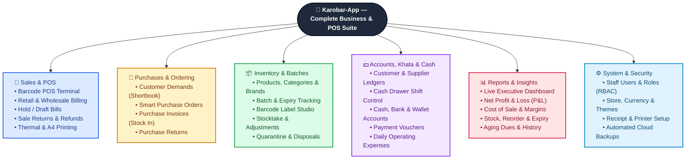

# 💼 Karobar-App (کاروبار)

## 📖 Overview

**Karobar-App** is a complete business management, billing, and inventory solution designed to help everyday business owners run their shops and warehouses smoothly. Instead of juggling paper registers (Khata), loose receipts, and manual calculators, Karobar-App brings your daily billing, stock tracking, customer accounts, supplier bills, and cash counter into one easy-to-use place.

Whether you are serving a busy line of walk-in customers at the counter or fulfilling bulk orders for regular credit buyers, Karobar-App keeps your numbers accurate and gives you a clear picture of your daily sales, stock levels, expenses, and real profit.

### What Karobar-App Does for You
* **Fast Counter Billing (POS):** Create cash or credit bills in seconds using a barcode scanner or quick keyboard shortcuts, print thermal receipts or full-page A4 invoices, and put bills on hold when a customer needs more time so the next person in line doesn't have to wait.
* **Smart Stock & Expiry Tracking:** Always know exactly what is on your shelves. Track products by pack or individual unit, manage batch numbers and expiry dates so older stock sells first, and get warned before items run out or expire.
* **Digital Customer & Supplier Khata (Ledgers):** Say goodbye to forgotten dues. Automatically track who owes you money and what you owe your suppliers, accept partial or advance payments, and print clean account statements whenever needed.
* **Cash Counter & Shift Tracking:** Keep track of every rupee or dollar entering and leaving your cash drawer during a shift—from cash sales and customer recoveries to petty shop expenses—and easily match your physical cash at closing time.
* **Clear Expenses & Profit Reports:** Record daily shop expenses like rent, electricity, salaries, and tea/refreshments, and instantly see your true net profit without complicated accounting math.

### Who Can Use Karobar-App?
Karobar-App is built to fit both **Retail** (selling single units to walk-in customers) and **Wholesale** (selling in packs and cartons with bulk discounts and credit terms), making it ideal for:

* **Pharmacies & Medical Stores:** Track medicine batches, expiry dates, strip/pack vs. tablet sales, and doctor/patient details for prescription items.
* **Wholesale & Distribution Businesses:** Manage bulk orders, bonus/free schemes, customer-specific pricing, and ongoing credit accounts.
* **Grocery Stores, Supermarkets & Karyana Stores:** Speed up checkout lines with barcode scanning, quick change calculation, and thermal receipt printing.
* **General Merchants, Hardware, Cosmetics & Auto Parts Shops:** Manage thousands of items, supplier purchases, returns, and customer balances effortlessly.
* **Traders & Multi-Counter Shops:** Give staff their own logins with controlled permissions so cashiers, storekeepers, and managers only see and do what their role allows.

---

## 🗺️ App Features Diagram

Below is a visual overview of the core modules and functions inside **Karobar-App**:

---

## 🧭 Detailed Module Guide (Sidebar Walkthrough)

Below is a complete walkthrough of every module in **Karobar-App**, following the exact order of the left navigation sidebar.

---

### 🏠 1. Dashboard
The **Dashboard** is your daily business command center. As soon as you log in, it gives you an instant health check of your shop without digging through menus.

* **Live KPI Cards:** View today's, this month's, or custom date-range **Gross Sales**, **Purchases**, **Sale & Purchase Returns**, **Net Profit**, **Customer Receivables (Dues)**, and **Supplier Payables**.
* **Interactive Sales & Profit Charts:** Visual trend charts comparing daily or monthly sales against purchases and returns so you can spot busy days and seasonal growth.
* **Expiry & Low-Stock Alerts:** Immediate warning badges showing how many batches are nearing expiry or already expired, and which fast-moving items need reordering.
* **Top Selling Products & Recent Activity:** See your best-performing products and recent bills at a glance.

---

### 📦 2. Management
The **Management** section holds all your master records—products, barcode labels, categories, brands, suppliers, and customers.

#### 2.1 Products
* **Complete Product Setup:** Add products with item name, generic/formula name, product code, barcode, category, brand, preferred supplier, rack/shelf location, and product image.
* **Pack & Unit Pricing:** Define **Pack Size** (e.g., 1 box = 10 strips or 30 tablets), **Pack Purchase Price**, **Pack Sale Price**, **Unit Purchase Price**, **Unit Sale Price**, and **Wholesale / Discount Rules**.
* **Stock & Narcotics Controls:** Set minimum stock alert levels (`reorder level`) and mark restricted/prescription medicines (`Narcotic / Prescription Required`) so the POS automatically asks for Doctor and Patient details during billing.
* **Bulk Import & Quick Search:** Search thousands of items instantaneously by name, barcode, generic formula, or category.

#### 2.2 Barcode Studio
A built-in label designer and barcode printing studio so you can tag products that arrive without manufacturer barcodes or print custom price stickers for your shelves.

* **Print Queue & Batch Selection:** Add one or multiple products to the print queue, pick specific batch numbers, and set exact label quantities per item.
* **Custom Label Designer:** Toggle what appears on the sticker—**Store Name**, **Product Name** (1 or 2 lines), **Product Code**, **Sale Price (MRP)**, **Batch Number**, **Manufacturing/Expiry Date**, and **Code-128 Barcode**.
* **Thermal Roll & A4 Sheet Layouts:** Supports single/double-column thermal sticker rolls (e.g., 50x25mm, 38x25mm) as well as multi-column A4 sticker sheets with customizable margins, gaps, and saved templates.

#### 2.3 Categories & Brands
* **Categories:** Organize your inventory into logical groups (e.g., *Antibiotics, Syrups, Surgical, Groceries, Cosmetics, Hardware*) for faster filtering and category-wise sales analysis.
* **Brands / Companies:** Record manufacturer or brand names (e.g., *GSK, Abbott, Unilever, Nestle*) to track brand performance and filter stock or purchase orders by company.

#### 2.4 Suppliers
* **Supplier Directory:** Maintain complete contact records for distributors, wholesalers, and company bookers—including contact person, phone number, address, tax/license numbers, and opening payable balance.
* **Direct Ledger Link:** View how much you owe any supplier and jump straight to their purchase history or ledger statement.

#### 2.5 Customers
* **Customer Directory:** Save regular retail and wholesale buyers with their phone number, address, credit limit, custom discount percentage, and opening balance.
* **Custom Wholesale Pricing:** Remembers customer-specific negotiated pack prices for repeat wholesale buyers.

---

### ⏳ 3. Batch & Expiry
Built specifically for pharmacies, grocery stores, and perishable goods businesses where batch tracking and shelf-life control protect your profit.

#### 3.1 Expiry & Tracking
* **Color-Coded Expiry Monitor:** Automatically groups all stock batches into **Expired**, **Expiring Soon (30 / 60 / 90 / 180 days)**, and **Safe Stock**.
* **Filter by Supplier or Brand:** Quickly pull up all expiring items from a specific distributor so you can hand them back to the supplier's order booker before their return window closes.
* **One-Click Actions:** Directly initiate a **Purchase Return** to the supplier or move expired stock to **Quarantine & Disposal** right from the expiry screen.

#### 3.2 Quarantine & Disposal
When stock is expired, broken, spoiled, or recalled and cannot be returned to a supplier, **Quarantine & Disposal** ensures it is removed from saleable stock cleanly and recorded as an audited business write-off.

* **Quarantine Holding Bay:** Move questionable or expired batches out of POS saleable stock into quarantine so cashiers cannot accidentally sell them.
* **Cause & Disposal Method Tracking:** Log the exact reason (*Shelf Expiry, Physical Breakage, Cold-Chain Spoilage, Defective Return, Manufacturer Recall, Pest/Water Damage*) and disposal method (*Incineration, Chemical Neutralization, Municipal Waste, Handed to Supplier*).
* **Official Disposal Certificate:** Generate and print a formal **Stock Destruction / Disposal Certificate** for regulatory or tax audits.

---

### 🧾 4. Invoices
The core billing engine of Karobar-App, supporting inward supplier stock and three specialized sales workflows.

#### 4.1 Purchase Invoice
* **Stock Inward & Batch Creation:** Enter supplier bills to immediately add stock into your inventory. Record **Batch Number**, **Expiry Date**, **Pack/Unit Quantities**, **Bonus/Free Units**, **Purchase Price**, **Discount %**, **Tax**, and **Sale Price (MRP)**.
* **Automatic Margin & Cost Calculation:** Calculates effective net unit cost (factoring in bonus units and discounts) and updates product pricing automatically.
* **Cash or Credit Settlement:** Pay the supplier immediately from your Cash Drawer / Bank Account, or post the bill on credit to the **Supplier Ledger**.

#### 4.2 Sale Invoice (Retail & Wholesale Modes)
Depending on your store configuration, Sale Invoices support two tailored modes:
* **Retail Sale Invoice:** Built for selling individual units or packs to walk-in or credit customers, complete with batch selection (FEFO—First Expiring, First Out), instant stock checks, item/invoice discounts, and doctor/patient fields for restricted items.
* **Wholesale Sale Invoice:** Built for distributors and wholesale counters—supports pack/carton quantities, loose units, bonus/free schemes, bulk discounts, previous customer balance visibility on the bill, and A4 invoice printing.
* **Hold & Resume Drafts (`Alt+H` / `Alt+D`):** Put an unfinished bill on hold if a customer steps away, serve other customers, and resume the held draft anytime with live stock re-verification.
* **Smart Overpayment Handling:** If a credit customer pays more than the current bill total, the extra amount is automatically credited to their **Customer Ledger** to reduce their previous dues.

#### 4.3 ⚡ Barcode POS (Fast Checkout Terminal)
A dedicated, full-screen, distraction-free counter terminal built for high-speed barcode scanning and keyboard-only operation.

* **Scan & Go Checkout:** Scan product barcodes continuously—each scan adds or increments the item immediately with audio feedback.
* **Visual Product Grid & Quick Search (`F2`):** Search by name or click product cards when an item doesn't have a barcode.
* **Instant Cash & Change Calculator:** Enter cash received, see large-font customer change due, and press `Enter` or `Alt+S` to save and auto-print a 78mm thermal receipt in one step.

---

### ↩️ 5. Returns
Handle customer refunds and supplier returns accurately without messing up your inventory counts or ledgers.

#### 5.1 Purchase Return
* **Return Stock to Suppliers:** Select the supplier and original purchase invoice (or batch) to return expired, near-expiry, damaged, or excess goods.
* **Automatic Stock & Ledger Update:** Deducts the returned quantities from the exact batch and automatically reduces your payable balance in the **Supplier Ledger** (or records a cash refund).

#### 5.2 Sale Return
* **Customer Returns & Refunds:** Look up the original sale invoice (by invoice number or barcode scan) or select items returned by a customer.
* **Batch Restoration & Refund Settlement:** Puts returned items back into their original inventory batch and either refunds cash from the **Cash Drawer** or credits the customer's **Khata (Ledger)** balance.

---

### 🛒 6. Transactions
Proactive inventory planning, shortage tracking, and physical stock auditing tools.

#### 6.1 Purchase Orders & Smart Reorder Forecasting
* **Demand Forecasting Engine:** Analyzes your historical sales velocity and current stock levels to recommend exactly which products to order and in what quantities.
* **Supplier Purchase Orders (PO):** Generate formal Purchase Orders for suppliers, track order status (*Draft, Sent, Partially Received, Completed*), and convert received orders into Purchase Invoices.

#### 6.2 User Demands (Shortbook / Wanted Items)
* **Daily Counter Shortbook:** When a customer asks for an item that is out of stock or not yet carried in your shop, cashiers can log it in **User Demands** in seconds.
* **Never Miss Sales Again:** At ordering time, review your User Demands list to turn customer requests into supplier orders.

#### 6.3 Stock Adjustments
* **Quick Count Corrections:** Make authorized manual additions or deductions to product batches when you find minor count differences, sample giveaways, or unpackaged units, with mandatory reason notes for full accountability.

#### 6.4 Stocktake Sessions (Physical Inventory Audit)
A structured multi-step workflow for conducting full-store or shelf-by-shelf physical stock counts:
1. **Start Session:** Create a stocktake session for the whole store, a specific category, or a specific brand.
2. **Physical Counting:** Staff enter the actual physical quantities counted on the shelves (`In Progress`).
3. **Variance Review (`Pending Review`):** Managers review a side-by-side comparison of **System Expected Stock** vs. **Physical Counted Stock**, highlighting shortages and overages with their exact financial value.
4. **Finalize & Sync (`Finalized`):** With one click, approve the session to automatically update all batch quantities to match the real physical count.

---

### 💵 7. Finance
Complete double-entry financial control covering customer credit (*Udhaar*), supplier payables, bank/wallet accounts, expenses, and cash drawer shifts.

#### 7.1 Supplier Ledger
* **Complete Accounts Payable Khata:** Select any supplier to view a chronological statement of all Purchase Invoices, Purchase Returns, Cash/Bank Payments, and the running balance you owe them.
* **Printable Statements:** Filter by date range and print or export A4 Supplier Account Statements.

#### 7.2 Customer Ledger
* **Digital Customer Khata (Udhaar Register):** Track every credit customer's invoices, partial payments, advance deposits, sale returns, and net outstanding balance.
* **Quick Settlement & Statements:** Settle individual open bills with one click or record lump-sum payments, and print clean A4 Customer Statements to share with buyers.

#### 7.3 Financial Accounts
* **Multi-Account Treasury:** Track real-time balances across all your business money channels—**Cash in Hand**, **Bank Accounts**, **Card / POS Terminals**, and **Mobile Wallets** (e.g., JazzCash, Easypaisa, SadaPay).
* **Deposits, Withdrawals & Inter-Account Transfers:** Record bank deposits, owner drawings, or transfers from the Cash Drawer to the Bank with full statement history for every account.

#### 7.4 Payment Vouchers
* **Unified Receipt & Payment Register:** A dedicated register for all incoming **Customer Receipts** and outgoing **Supplier Payments** across Cash, Bank Transfer, Cheque, Card, or Mobile Wallet.
* **Smart Multi-Invoice Allocation:** When a customer or supplier payment is recorded, automatically allocate the payment across oldest open invoices (`FIFO`) or pick specific bills to settle, and print or share a formal **Payment Voucher Receipt**.

#### 7.5 Operating Expenses
* **Daily Shop Expense (Kharcha) Tracking:** Log all day-to-day shop overheads across standard categories (*Shop Rent, Staff Salaries, Electricity/WAPDA, Generator Fuel, Tea & Refreshments, Packaging, Freight/Delivery, Maintenance*).
* **Direct Cash Drawer & Bank Deduction:** Choose whether the expense was paid from the active **Cash Drawer** or a **Bank / Wallet Account**, keeping your cash count and Net Profit report 100% accurate.

#### 7.6 Cash Drawer
Eliminate end-of-day cash confusion with shift-based counter reconciliation:
* **Open Shift with Starting Float:** Cashiers start their shift by entering the opening cash float in the drawer.
* **Live Shift Activity Log:** Every cash sale, customer recovery, cash refund, petty cash expense (`Cash Out`), and float top-up (`Cash In`) is logged automatically in real time—accessible anytime from the top navigation bar widget.
* **Close Shift & Variance Check:** At shift end, the cashier enters the physical cash counted in the drawer. The system compares **Expected Cash** vs. **Counted Cash**, highlights any **Shortage or Overage**, and saves the closed shift report for the owner.

---

### 📊 8. Reports
14 specialized business, inventory, and financial reports—each with date/category/party filters, print-ready layouts, and exports.

| Report Name | What It Tells You |
| :--- | :--- |
| **1. Net Profit (P&L)** | Complete Profit & Loss statement showing Gross Sales, Returns, Cost of Goods Sold (COGS), Gross Profit, itemized Operating Expenses, Net Profit, and Net Profit Margin %. |
| **2. Current Stock** | Real-time stock valuation report showing available packs/units, purchase value, and retail sale value across your entire inventory. |
| **3. Cost of Sale** | Summary of total sales revenue vs. historical cost of goods sold and gross profit earned over any date range. |
| **4. Cost of Sale Detail** | Invoice-by-invoice and item-by-item breakdown of sale price, exact batch cost at the time of sale, and profit margin per transaction. |
| **5. Purchase Detail** | Itemized report of all stock purchased, filtered by date, supplier, product, or batch. |
| **6. Sale Detail** | Itemized report of all products sold, filtered by date, customer, cashier/user, category, or brand. |
| **7. Stock Adjustment** | Audit report of all manual stock additions, deductions, and physical count adjustments with staff reasons. |
| **8. Product Comprehensive** | Complete lifecycle history (stock card) of a single product—showing every purchase, sale, return, and adjustment from day one. |
| **9. Near Expiry Product** | Printable list of batches expiring within your chosen timeframe so you can discount or return them before loss occurs. |
| **10. Purchase Returns** | Detailed register of all goods returned to suppliers and the corresponding credit/refund amounts. |
| **11. Sale Returns** | Detailed register of all customer returns and refunds issued at the counter. |
| **12. Purchase Summary** | High-level supplier-wise and date-wise summary of total procurement spend. |
| **13. Outstanding Aging** | Breaks down unpaid customer receivables and supplier payables by age (*0–30, 31–60, 61–90, and 90+ days overdue*) to speed up recoveries. |
| **14. Low Stock & Reorder** | Lists all products that have fallen below their minimum stock threshold so you can reorder before running out. |

---

### ⚙️ 9. System
Configure your store identity, billing rules, visual appearance, receipt templates, backups, and staff permissions.

#### 9.1 Settings
Organized into 5 easy configuration tabs:
* **General Settings:** Set your Store Name, Logo, Phone Number, Address, Tax/License Number, Receipt Footer Note, and **Currency Formatting** (Currency Code, Symbol like `Rs.` or `$`, symbol position, and decimal places).
* **Sale System Settings:** Choose your store's operating mode (**Retail Only**, **Wholesale Only**, or **Both Retail & Wholesale**) and shop type (e.g., Pharmacy, General Store).
* **Theme Settings:** Customize the app's visual appearance—toggle **Light / Dark Mode**, pick custom **Primary, Secondary, and Tertiary brand colors**, and choose button styles.
* **Printer Settings:** Choose between **78mm Thermal Receipt Printer** and **A4 Full-Page Printer**, and pick from 6 thermal templates (*Standard, Compact, Detailed, Bold, Minimal, Barcode*) and custom A4 invoice templates.
* **License Settings:** View your software license status, validity, and activation details.

#### 9.2 Backups & Storage
Protect your business data against computer crashes or accidental deletion:
* **One-Click Manual Backups:** Create an instant **Full Backup** (Database + Settings + Uploaded Files), **Database Only (SQL)**, or **Settings Only (JSON)** archive at any time.
* **Automated Scheduled Backups:** Schedule daily, weekly, or monthly automatic backups with retention limits so old backups are cleaned up automatically.
* **Local & Cloud Offsite Sync:** Store backups in a local folder or sync them offsite, download archives to a USB drive, or restore your system from any backup point.

#### 9.3 Users & Roles (Staff Access Control)
* **Users:** Create individual login accounts for cashiers, pharmacists, storekeepers, accountants, and managers.
* **Roles & Granular Permissions:** Define custom roles and tick exactly which screens and actions each role is allowed to access (e.g., allow a Cashier to create POS bills and view products, while hiding Net Profit reports, purchase costs, and invoice deletion).

