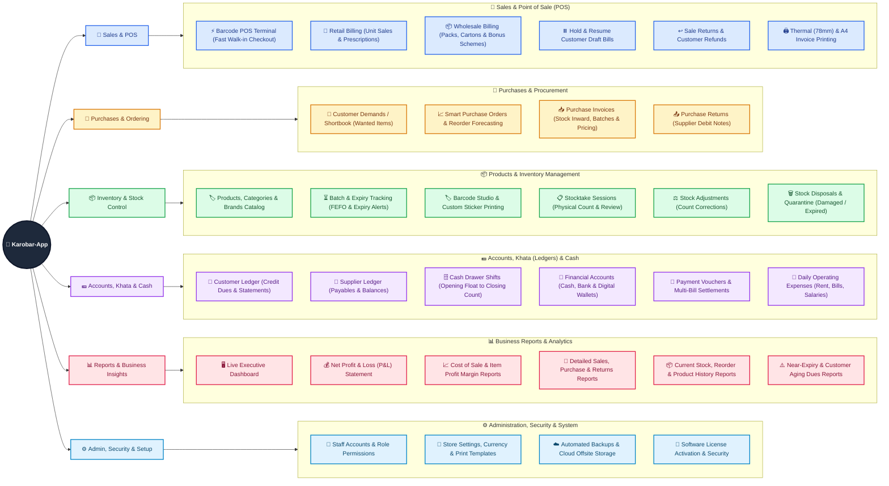

# 💼 Karobar-App (کاروبار)

## 📖 Overview

**Karobar-App** is a complete business management, billing, and inventory solution designed to help everyday business owners run their shops and warehouses smoothly. Instead of juggling paper registers (Khata), loose receipts, and manual calculators, Karobar-App brings your daily billing, stock tracking, customer accounts, supplier bills, and cash counter into one easy-to-use place.

Whether you are serving a busy line of walk-in customers at the counter or fulfilling bulk orders for regular credit buyers, Karobar-App keeps your numbers accurate and gives you a clear picture of your daily sales, stock levels, expenses, and real profit.

### What Karobar-App Does for You
* **Fast Counter Billing (POS):** Create cash or credit bills in seconds using a barcode scanner or quick keyboard shortcuts, print thermal receipts or full-page A4 invoices, and put bills on hold when a customer needs more time so the next person in line doesn't have to wait.
* **Smart Stock & Expiry Tracking:** Always know exactly what is on your shelves. Track products by pack or individual unit, manage batch numbers and expiry dates so older stock sells first, and get warned before items run out or expire.
* **Digital Customer & Supplier Khata (Ledgers):** Say goodbye to forgotten dues. Automatically track who owes you money and what you owe your suppliers, accept partial or advance payments, and print clean account statements whenever needed.
* **Cash Counter & Shift Tracking:** Keep track of every rupee or dollar entering and leaving your cash drawer during a shift—from cash sales and customer recoveries to petty shop expenses—and easily match your physical cash at closing time.
* **Clear Expenses & Profit Reports:** Record daily shop expenses like rent, electricity, salaries, and tea/refreshments, and instantly see your true net profit without complicated accounting math.

### Who Can Use Karobar-App?
Karobar-App is built to fit both **Retail** (selling single units to walk-in customers) and **Wholesale** (selling in packs and cartons with bulk discounts and credit terms), making it ideal for:

* **Pharmacies & Medical Stores:** Track medicine batches, expiry dates, strip/pack vs. tablet sales, and doctor/patient details for prescription items.
* **Wholesale & Distribution Businesses:** Manage bulk orders, bonus/free schemes, customer-specific pricing, and ongoing credit accounts.
* **Grocery Stores, Supermarkets & Karyana Stores:** Speed up checkout lines with barcode scanning, quick change calculation, and thermal receipt printing.
* **General Merchants, Hardware, Cosmetics & Auto Parts Shops:** Manage thousands of items, supplier purchases, returns, and customer balances effortlessly.
* **Traders & Multi-Counter Shops:** Give staff their own logins with controlled permissions so cashiers, storekeepers, and managers only see and do what their role allows.

---

## 🗺️ App Features Diagram

Below is a complete visual map of every module and function available inside **Karobar-App**:

---

## 🗺️ App Features Diagram

Below is a complete visual map of every module and function available inside **Karobar-App**:

