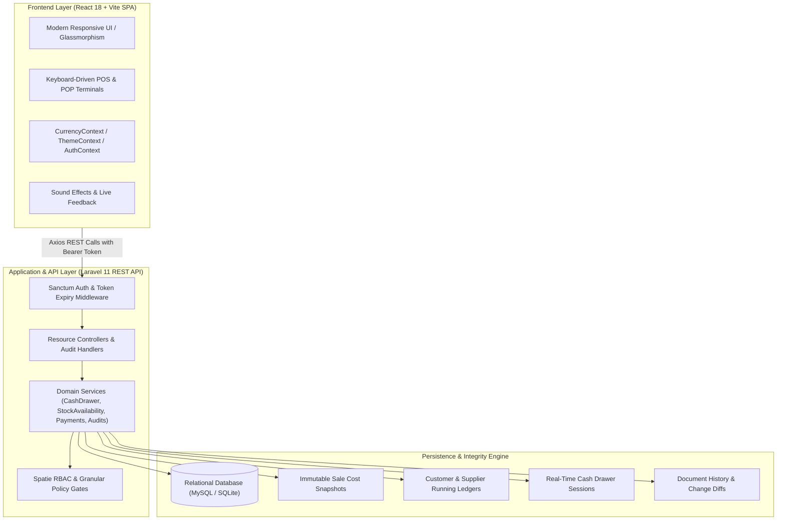
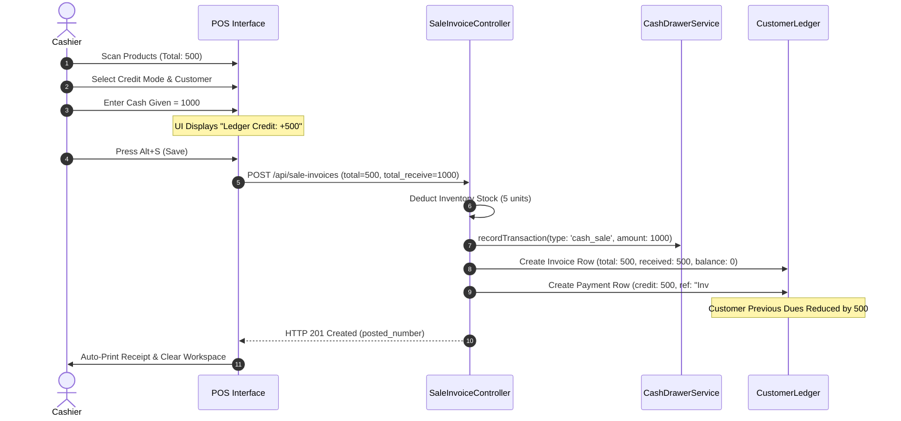
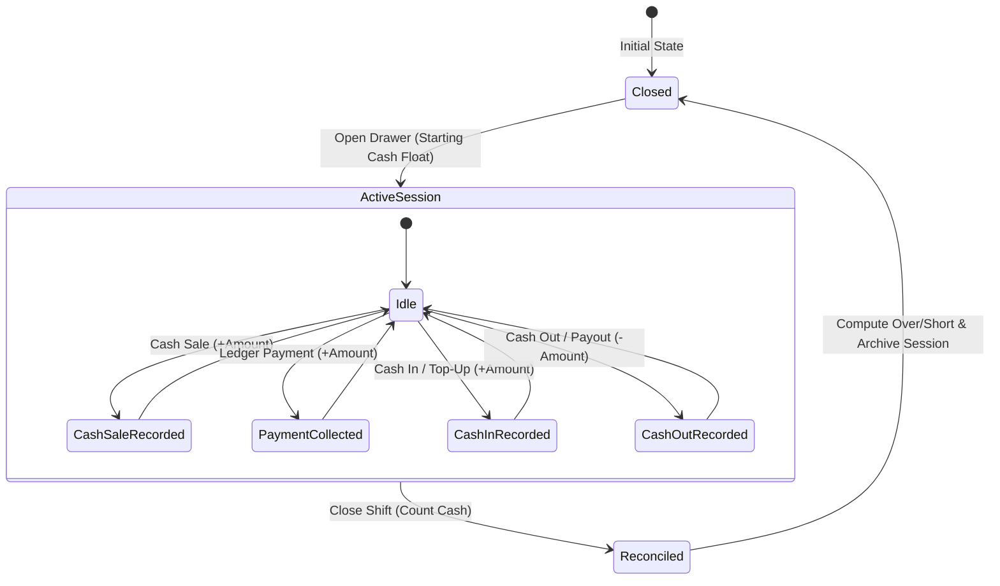
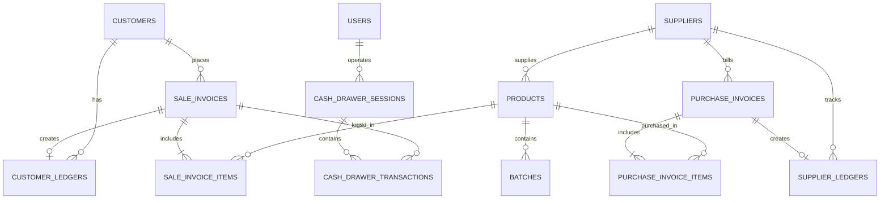

# 💼 Karobar-App (کاروبار)

<div align="center">


**An enterprise-grade, modern Point of Sale (POS), Point of Purchase (POP), Batch Inventory, Double-Entry Ledger, and Cash Drawer Management System.**

[Key Features](#-key-features) • [System Architecture](#-system-architecture) • [Workflows & Diagrams](#-workflows--diagrams) • [Keyboard Shortcuts](#-pos-keyboard-shortcuts) • [Installation & Setup](#-installation--setup) • [Testing](#-testing--quality-assurance)

</div>

---

## 📖 Executive Summary

**Karobar-App** is a business management and ERP solution engineered for fast-paced retail pharmacies, wholesale distributors, general merchants, and trading businesses. It replaces error-prone spreadsheets and paper registers with an automated, transactional platform featuring keyboard-driven POS operations, real-time inventory tracking, batch & expiry controls, cash drawer tracking, dual-mode customer/supplier ledgers, and audit trails.

---

## 🏗️ System Architecture



---

## 🚀 Key Features

### 1. ⚡ High-Speed Sales & Point of Sale (POS)

* **Dual Operational Modes**:
  * **Retail Mode**: Ultra-fast barcode scanner-ready interface, unit pricing, prescription narcotics compliance (mandatory doctor & patient tracking for pharmacies).
  * **Wholesale Mode**: Supports pack and unit sales, bulk discounts, bonus schemes, and persistent customer-specific custom pack pricing.
* **Cash (Debit) vs. Credit Workflows**:
  * **Debit (Cash Sales)**: Automatically logs cash receipts into the active cash drawer session and prints customer change receipts.
  * **Credit Sales**: Links invoice balances directly to the customer ledger with partial payment collection and automated remaining balance tracking.
* **Credit Overpayment Handling**:
  * When a customer pays more than the invoice total (e.g., bill is ₨ 500 but customer pays ₨ 1,000 note), the system marks the invoice as fully settled and automatically records the excess ₨ 500 as an advance payment in the customer ledger, automatically offsetting any previous debt.
* **Held Invoices & Drafts Engine**:
  * Hold active transactions on-the-fly (`Alt+H`) with optimistic concurrency version control.
  * Live elapsed time counter with drafts resume modal (`InvoiceDraftsModal`) supporting full dark/light modes.
  * Automatic quantity and stock availability verification upon resuming held drafts.
* **Invoice Reversals & Auditing**:
  * Soft reversals with mandatory audit reasoning that automatically restore physical stock to the exact originating batch and reconcile ledger entries.

---

### 2. 🖨️ Thermal & A4 Printing Engine

* **78mm Thermal Receipt Templates**:
  * **Standard**: Clean layout with itemization, taxes, discounts, tender details, and customer ledger summary.
  * **Compact**: Minimal line spacing designed to save paper on high-volume lanes.
  * **Detailed**: Comprehensive breakdown with product code, pack size, batch number, and expiry date.
  * **Bold**: High-contrast, dark-text rendering optimized for low-heat thermal heads.
  * **Minimal**: Streamlined ticket displaying totals, payment method, and receipt footer.
  * **Barcode**: Prints scan-ready Code128 barcodes of the invoice number for lightning-fast returns and lookup.
* **A4 Multi-Page Invoices**:
  * Enterprise-grade printable letterhead formats with company logo, tax registration numbers, terms and conditions, and dual signature blocks.

---

### 3. 💵 Real-Time Cash Drawer Management

* **Session Lifecycle**:
  * Cashiers open a drawer session with opening float cash (`start_cash`).
  * Live tracking of all cash transactions throughout the shift without needing a page refresh:
    * `cash_sale`: Inbound cash from retail and credit POS sales.
    * `customer_payment`: Cash received through ledger payment settlements.
    * `cash_in`: Ad-hoc floats, top-ups, or drawer additions.
    * `cash_out`: Petty cash payouts, expense withdrawals, or owner draws.
* **Shift Closing & Variance Reconciliation**:
  * Cashiers enter physical cash counts upon closing.
  * System calculates **Expected Cash** vs. **Counted Cash**, automatically computing overage or shortage (`variance`) and archiving the reconciliation record.
* **Global Topbar Widget**:
  * Quick status pill in the top navigation bar displaying active drawer status, current balance, and one-click drawer reconciliation modal with click-outside dismissal.

---

### 4. 🛒 Point of Purchase (POP) & Supplier Fulfillment

* **Purchase Order Lifecycle**:
  * Draft, submitted, partially received, completed, and canceled order states.
  * Supports split-batch receipts, bonus/free units, custom pack sizes, and supplier price tracking.
* **Direct Purchase Invoices**:
  * Instant stock accretion into specific batch numbers with expiry dates, purchase prices, and retail markups.
* **Purchase Returns & Debit Notes**:
  * Return defective or expired items back to suppliers with automated supplier ledger debits and batch stock deductions.

---

### 5. 📒 Financial Accounting & Dual Ledgers

* **Customer Ledger**:
  * Complete double-entry running ledger tracking all credit invoices, cash payments, bank transfers, manual debit/credit adjustments, and excess payments.
  * Instant calculation of total invoiced, total received, payments credited, and net outstanding due.
  * One-click "Mark Invoice as Paid" settlement shortcut.
  * Exportable and printable A4 Customer Statement PDF with date filtering (`from` / `to`).
* **Supplier Ledger**:
  * Comprehensive accounts payable ledger tracking purchase invoices, disbursements, returned goods credits, and net payable balances.
* **Payment Allocation Engine**:
  * Multi-invoice payment distribution allocating lump-sum payments across open customer invoices, retaining unapplied advances as open credit balance with complete idempotency protection.

---

### 6. 📦 Inventory, Batches & Immutable Cost Snapshots

* **Batch & Expiry Controls**:
  * Multi-batch inventory tracking with FEFO (First Expiring, First Out) and FIFO selection.
  * Color-coded near-expiry warnings and zero-stock locks to prevent overselling.
* **Frozen Historical Cost Snapshots**:
  * Each sale invoice line permanently captures the effective cost of goods sold (COGS) at the precise moment of sale.
  * Guarantees immutable gross profit reporting even if purchase prices change backdatedly or supplier invoices are modified later.
* **Stock Adjustments**:
  * Record physical inventory count reconciliations, shrinkage, damages, or expiries with automated inventory balance adjustments.

---

### 7. 🌍 Currency & Global Localization

* **Configurable Currency Settings**:
  * Configure custom currency code (e.g. `PKR`, `USD`, `EUR`, `GBP`, `AED`, `SAR`).
  * Custom currency symbol, decimal places (0 to 4), symbol placement (`left` / `right` / `left_space` / `right_space`), and thousands separators.
  * Integrated across the entire interface using React Select with full light/dark theme support.

---

### 8. 🛡️ Security, RBAC & Document Audit Trail

* **Granular Role-Based Access Control (RBAC)**:
  * Powered by Spatie Laravel-Permission.
  * Separate permissions for sales, purchases, customer ledgers, supplier ledgers, stock adjustments, reports, users, roles, and settings.
* **Document Audit History**:
  * Full chronological trail recording creation snapshots, updates with precise field diffs, and reversals with authorizing user details.

---

## 🔄 Workflows & Diagrams

### Sales POS & Overpayment Workflow



---

### Cash Drawer Shift Lifecycle



---

## ⌨️ POS Keyboard Shortcuts

Boost cashier checkout speeds with built-in hotkeys:

| Shortcut | Action | Description |
| :--- | :--- | :--- |
| <kbd>Alt</kbd> + <kbd>S</kbd> | **Save / Create Sale** | Validates and submits the active sale invoice. |
| <kbd>Alt</kbd> + <kbd>P</kbd> | **Print Invoice** | Triggers thermal/A4 receipt printing for the current invoice. |
| <kbd>Alt</kbd> + <kbd>N</kbd> | **New Invoice** | Clears the workspace and prepares a fresh blank invoice. |
| <kbd>Alt</kbd> + <kbd>H</kbd> | **Hold / Draft** | Places current items on hold and opens a blank workspace. |
| <kbd>Alt</kbd> + <kbd>D</kbd> | **Open Drafts** | Opens the Held Invoices & Drafts modal to resume a customer. |
| <kbd>Alt</kbd> + <kbd>C</kbd> | **Customer Search** | Opens the modal to search or create customers on-the-fly. |
| <kbd>F2</kbd> | **Product Search** | Focuses the product search selector in the active item row. |
| <kbd>Alt</kbd> + <kbd>A</kbd> | **Add Item Row** | Appends a new item line to the sales table. |
| <kbd>Enter</kbd> *(in Cash)* | **Submit POS** | Submits the invoice directly when pressing Enter in Cash Given. |

---

## 🗄️ Database Entity Architecture



---

## 🛠️ Technology Stack

| Layer | Technology | Details |
| :--- | :--- | :--- |
| **Backend Framework** | Laravel 11.x | PHP 8.2+, Eloquent ORM, Database Transactions, Policies |
| **Authentication** | Laravel Sanctum | Token-based API authentication with automated expiry middleware |
| **Frontend Framework** | React 18.x | Single Page Application (SPA), Functional Components, Hooks |
| **Bundler & Tooling** | Vite 6.x | Lightning-fast HMR and optimized production asset minification |
| **Styling & Design** | Tailwind CSS 3.x | Custom glassmorphism, responsive grid layout, full Dark Mode |
| **UI Components** | React Select, Heroicons | Accessible dropdowns, searchable selects, vector iconography |
| **State Management** | React Context API | `AuthContext`, `ThemeContext`, `CurrencyContext`, `DrawerContext` |
| **Database** | MySQL 8.x / SQLite | Relational schema with foreign key cascades and composite indexes |
| **Testing Suite** | PHPUnit 10.x | Comprehensive feature and unit tests with SQLite in-memory runner |

---

## 📁 Repository Directory Structure

```text
Karobar-App/
├── app/
│   ├── Http/
│   │   ├── Controllers/         # API controllers (Sales, Purchases, Ledgers, Drawer)
│   │   └── Middleware/          # Auth, token expiration, license validation
│   ├── Models/                  # Eloquent models (Customer, Product, Ledger, Invoice)
│   ├── Policies/                # Authorization policies (Sales, Drawer, Ledgers)
│   └── Services/                # Core business engines (CashDrawer, Stock, Audit, Payments)
├── database/
│   ├── migrations/              # Versioned database migrations
│   └── seeders/                 # Database seeders (Roles, Permissions, Defaults)
├── resources/
│   ├── css/                     # Tailwind styling and custom layout rules
│   ├── js/
│   │   ├── components/          # Reusable UI widgets, Modals, Topbar, Search Selects
│   │   ├── context/             # Global Contexts (Currency, Theme, Permissions, Auth)
│   │   ├── pages/               # Route views (POS Forms, Ledgers, Reports, Settings)
│   │   └── App.jsx              # React main application router
│   └── views/
│       ├── printer/             # Blade print layouts (Thermal & A4 templates)
│       └── index.blade.php      # Main SPA entrypoint blade
├── routes/
│   ├── api.php                  # Protected REST API endpoints
│   └── web.php                  # Thermal/A4 print routes & SPA fallback
├── tests/
│   ├── Feature/                 # Feature integration tests (POS, Ledgers, Drawers)
│   └── Unit/                    # Domain unit tests
└── package.json                 # Node scripts & frontend libraries
```

---

## ⚙️ Installation & Setup

### Prerequisites

Ensure you have the following installed on your host system:
* **PHP** >= 8.2 (with `pdo`, `mbstring`, `openssl`, `bcmath`, `curl`)
* **Composer** >= 2.x
* **Node.js** >= 18.x & **NPM**
* **MySQL** >= 8.0 or **MariaDB** >= 10.4 (or SQLite for testing)

---

### Step-by-Step Installation

#### 1. Clone the Repository
```bash
git clone https://github.com/shzdasim/Karobar-App.git
cd Karobar-App
```

#### 2. Install PHP Dependencies
```bash
composer install
```

#### 3. Environment Configuration
```bash
cp .env.example .env
php artisan key:generate
```

Open `.env` and configure your database connection:
```ini
DB_CONNECTION=mysql
DB_HOST=127.0.0.1
DB_PORT=3306
DB_DATABASE=karobar_db
DB_USERNAME=root
DB_PASSWORD=your_password
```

#### 4. Run Database Migrations & Seeders
```bash
php artisan migrate --seed
```

#### 5. Install Node Dependencies & Build Frontend
```bash
npm install
npm run build
```
*(For active frontend development with Hot Module Replacement, run `npm run dev` instead).*

#### 6. Start the Local Server
```bash
php artisan serve
```

Navigate to **`http://localhost:8000`** in your browser.

---

## 🧪 Testing & Quality Assurance

Karobar-App includes a test suite covering transactions, cash drawer math, audit snapshot integrity, overpayment ledger allocation, and draft concurrency.

Run all tests via PHPUnit:
```bash
php artisan test
```

Execute a targeted test suite:
```bash
# Test credit invoice overpayments & customer ledger sync
php artisan test --filter=CreditInvoiceOverpaymentTest

# Test cash drawer session lifecycles & variance reconciliation
php artisan test --filter=CashDrawerTest

# Test payment allocations and advance balance handling
php artisan test --filter=PaymentAndAllocationTest
```

---

## 🤝 Contribution Guidelines

We welcome contributions from the developer community:
1. **Fork** the repository on GitHub.
2. **Create** your feature branch (`git checkout -b feature/AmazingFeature`).
3. **Commit** your changes with descriptive messages (`git commit -m 'feat: Add barcode thermal template'`).
4. **Push** to the branch (`git push origin feature/AmazingFeature`).
5. **Open** a Pull Request.

---

## 📜 License

This project is open-source software licensed under the **[MIT License](LICENSE)**.

---

## 👤 Author & Support

**Muhammad Asim Shahzad**  
* GitHub: [@shzdasim](https://github.com/shzdasim)  
* Project Link: [https://github.com/shzdasim/Karobar-App](https://github.com/shzdasim/Karobar-App)

> *Karobar-App – Simplifying Business, Empowering Growth.*
